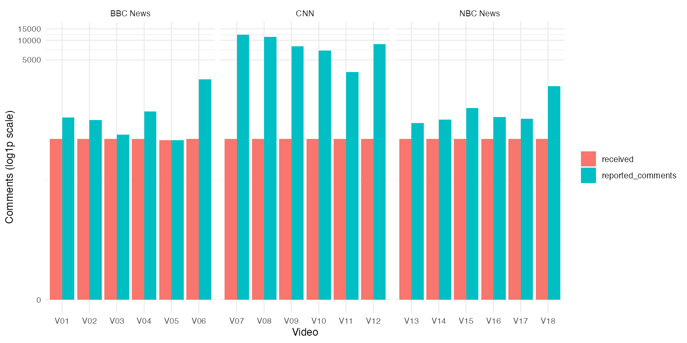
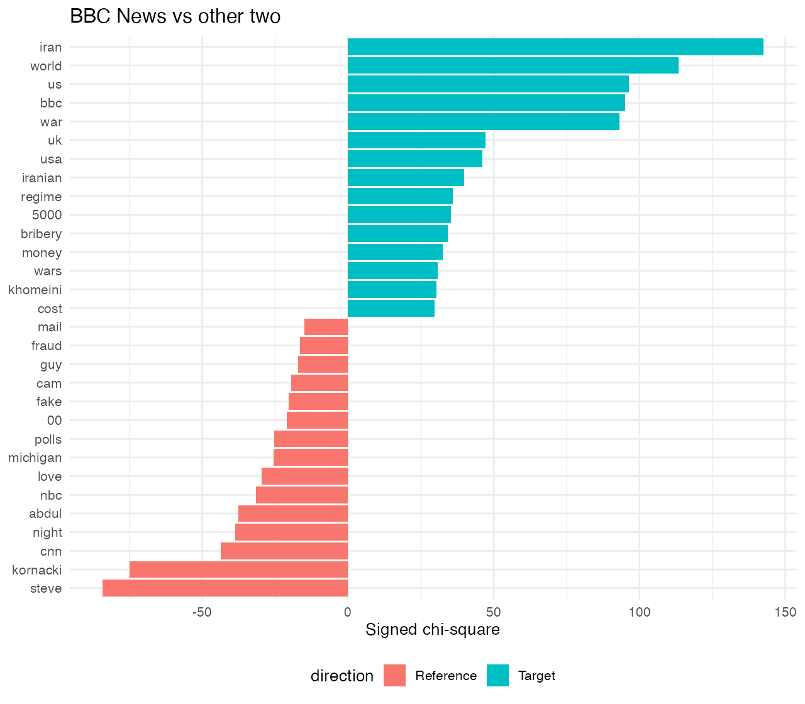
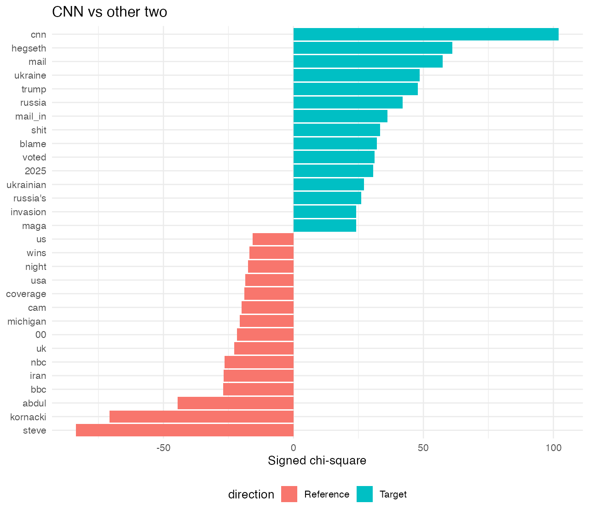
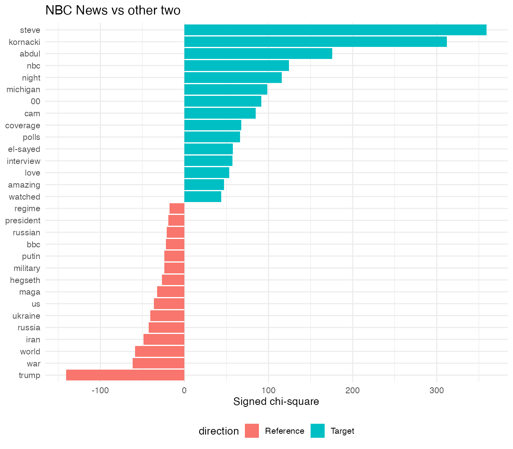
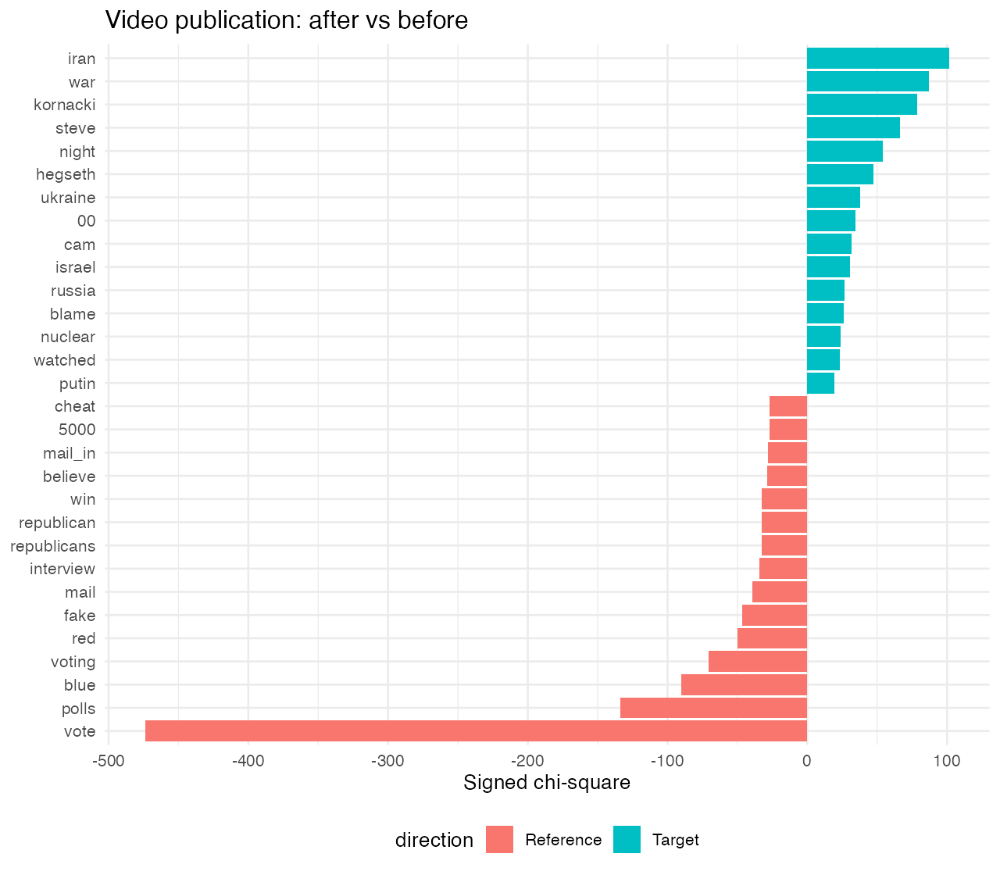
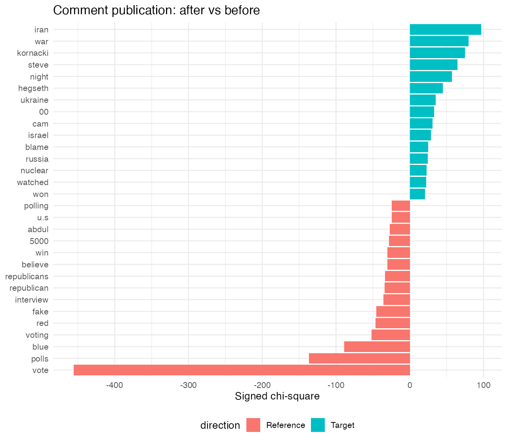
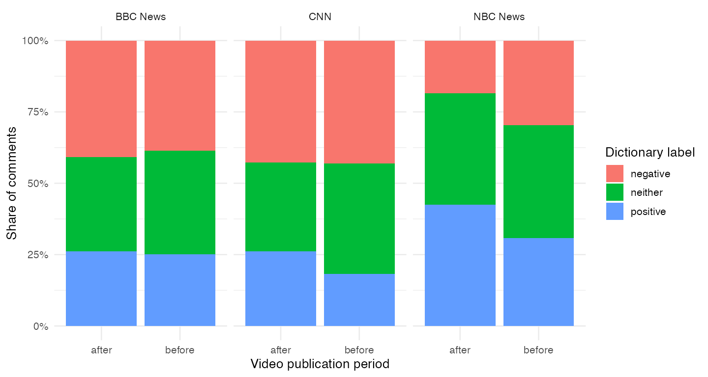

```{=html}
<style>
/* Assignment 7 only: preserve the shared course-site layout. */
.assignment-report.assignment07-report {
  min-width: 0;
  overflow-wrap: break-word;
}
.assignment07-report table {
  display: table !important;
  width: 100% !important;
  max-width: 100%;
  table-layout: auto !important;
  border-collapse: collapse;
  margin: 14px 0 24px;
  font-size: 0.88em;
  line-height: 1.5;
}
.assignment07-report table colgroup { display: table-column-group !important; }
.assignment07-report table col { display: table-column !important; width: auto !important; }
.assignment07-report table thead { display: table-header-group !important; }
.assignment07-report table tbody { display: table-row-group !important; }
.assignment07-report table tfoot { display: table-footer-group !important; }
.assignment07-report table tr { display: table-row !important; width: auto !important; }
.assignment07-report table th,
.assignment07-report table td {
  display: table-cell !important;
  width: auto !important;
  min-width: 0;
  padding: 9px 12px !important;
  vertical-align: top;
  white-space: normal;
  overflow-wrap: normal;
  border-bottom: 1px solid #dedede;
}
.assignment07-report table th {
  font-weight: 600;
  border-top: 1px solid #999;
  border-bottom: 1px solid #999;
  background: #f7f7f7;
}
.assignment07-report table caption {
  caption-side: top;
  text-align: left;
  font-weight: 500;
  padding: 0 0 8px;
}
.assignment07-report .cell-output-display,
.assignment07-report .quarto-table-container,
.assignment07-report .table-responsive {
  display: block;
  max-width: 100%;
  overflow-x: auto;
}
.assignment07-report pre { max-width: 100%; overflow-x: auto; }
.assignment07-report details { margin: 12px 0 18px; }
.assignment07-report img { max-width: 100%; height: auto; }
@media (max-width: 780px) {
  .assignment07-report table { font-size: 0.8em; }
  .assignment07-report table th,
  .assignment07-report table td { padding: 7px 8px !important; }
}
.assignment07-report details.audit-table { max-width: 100%; overflow-x: auto; }
.assignment07-report figure img { display: block; margin: 0 auto; }
</style>
```

:::: {.assignment-report .assignment07-report}

# Assignment 7: Social Media Data from the YouTube API

**YouTube Comments on the 2026 U.S. Midterm Elections**  
EPPS 6302 — Methods of Data Collection and Production | Fall 2026

## 1. Data note and quota plan

The [YouTube Data API v3](https://developers.google.com/youtube/v3) was accessed November 26, 2026 (Central Time), using tuber 3.0.0, httr2 1.3.0 and an API key in `.Renviron`. The API-only workflow excluded scraping and OAuth. The precollection quota plan budgeted 8 searches and 7,811 ordinary units; tuber recorded 8 and 299, respectively. Under the assignment’s [Developer Policies](https://developers.google.com/youtube/terms/developer-policies) retention rule, raw API data and private coding files must be deleted by December 26, 2026.

| Endpoint | Planned | Observed |
| --- | --- | --- |
| Search (separate bucket) | 8 | 8 |
| Channel details | 3 | 3 |
| Uploads playlist | 900 | 203 |
| Video statistics | 908 | 22 |
| Comment threads and replies | 6000 | 71 |

Ordinary-unit breakdown is reconciled from stage counters and batch counts, not independent billing records.

## 2. Video discovery and selection

The query `US midterm election` used relevance and view-count rankings for September 1–October 27 and November 4–26 (UTC boundaries; final cutoff November 27 00:43:16 UTC). Each returned 100 rows despite estimated totals of one million. Relevance duplicates numbered seven before and three after. Ranking overlap was 23 and 36, respectively. Within-window unions were 170 and 161; the global index contained 325 IDs, indicating six cross-window duplicate memberships despite disjoint requested dates. This discrepancy requires caution about search metadata. CNN dominated view-count rankings (33 before, 23 after); Al Jazeera English led pre-window relevance (9), CNN post-window relevance (10).

| Period | Order | Reported total | Returned | Duplicates | Unique |
| --- | --- | --- | --- | --- | --- |
| before | relevance | 1000000 | 100 | 7 | 93 |
| before | viewCount | 1000000 | 100 | 0 | 100 |
| after | relevance | 1000000 | 100 | 3 | 97 |
| after | viewCount | 1000000 | 100 | 0 | 100 |

| Period | Relevance unique | View-count unique | Overlap | Within-period union |
|---|---:|---:|---:|---:|
| Before | 93 | 100 | 23 | 170 |
| After | 97 | 100 | 36 | 161 |

NBC News (national broadcast), CNN (cable) and BBC News (international) represent differing media types. Upload playlists reached September 1 after 203 pages. The filter retained 819 of 9,227 in-window uploads; 763 were absent from pooled search results. Reviewing 20 retained and 20 rejected titles per channel revealed foreign elections and unrelated votes as false positives and primary and governor-race headlines as potential false negatives. Three high-view, substantively relevant videos per channel-period were selected without conditioning on comment counts.

| Channel | Upload pages | Raw upload rows |
| --- | --- | --- |
| BBC News | 39 | 1950 |
| CNN | 72 | 3600 |
| NBC News | 92 | 4600 |
| Channel | Period | Uploads | Kept | Dropped | Kept missed by search |
| --- | --- | --- | --- | --- | --- |
| BBC News | before | 1271 | 69 | 1202 | 66 |
| BBC News | after | 500 | 44 | 456 | 43 |
| CNN | before | 2095 | 206 | 1889 | 179 |
| CNN | after | 1124 | 149 | 975 | 130 |
| NBC News | before | 2889 | 200 | 2689 | 196 |
| NBC News | after | 1348 | 151 | 1197 | 149 |

Exact title filter (case insensitive):

```text
\b(midterms?|elections?|senate|house\s+(race|majority|control|of representatives)|ballots?|vot(e|es|ed|ing|ers?)|congress(ional)?)\b
```

## 3. Comment collection and participation

The adapted `collect_comments()` wrapper retained replies and deduplicated comment IDs before a many-to-one video join. All 18 videos succeeded; 5,387 of 60,937 reported comments were retrieved (8.84%). Seventeen reached the 300 cap; one returned 287. Coverage ranged from 2.45% to 100%; caps, moderation, deletions and inaccessible replies may explain the gap, but their individual contributions are unknown. Replies comprised 18.51%; 59 repeated-text rows remained. The top 54 comments received 55.82% of 9,351 likes; the top 448 of 4,473 authors produced 24.43% of comments. Median likes were zero (90th percentile: 2; 99th: 20).

| Channel | Period | Comments | Replies | Reply share | Likes |
| --- | --- | --- | --- | --- | --- |
| BBC News | after | 900 | 187 | 20.8% | 1608 |
| BBC News | before | 887 | 128 | 14.4% | 1409 |
| CNN | after | 900 | 337 | 37.4% | 2013 |
| CNN | before | 900 | 144 | 16.0% | 968 |
| NBC News | after | 900 | 81 | 9.0% | 2539 |
| NBC News | before | 900 | 120 | 13.3% | 814 |

{width="85%"}

## 4. KWIC, phrases and keyness

One comment is one document, with channel, video, reply status, likes, date and period as docvars. HTML, URLs, mentions, punctuation and emoji were removed; text was lowercased. After two blanks were excluded, stopword removal and minimum document frequency of two left 5,256 documents and 5,278 features for keyness. Twenty KWIC contexts per pattern were classified: 40 party, 20 candidate and 40 process. The primary-reference convention yielded no grievance codes, potentially obscuring grievances in procedural references. Added compounds were republican party and democratic senator.

| Pattern | Matches | Documents | Reviewed | Recorded category |
| --- | --- | --- | --- | --- |
| democrat* | 518 | 414 | 20 | party |
| republican* | 488 | 380 | 20 | party |
| trump | 1273 | 962 | 20 | candidate |
| vote* | 1030 | 727 | 20 | process |
| ballot* | 126 | 105 | 20 | process |
| Compound | Occurrences | Documents |
| --- | --- | --- |
| house majority | 2 | 2 |
| senate race | 9 | 6 |
| early voting | 10 | 8 |
| mail in | 28 | 27 |
| election fraud | 3 | 3 |
| republican party | 49 | 43 |
| democratic senator | 1 | 1 |

Signed chi-square keyness contrasts each channel with the other two. BBC emphasized iran, world and war; CNN featured cnn, hegseth and ukraine; NBC featured steve, kornacki and abdul. Vote and polls were more distinctive before, iran and war after. Grouping by comment date yielded similar results, excluding 71 Election Day comments. Pre-election videos also contained 54 post-election comments. Thus the primary comparison concerns video publication, not historical collection times. Topics, hosts, audience selection and dependence among comments preclude causal interpretation.

{width="85%"}

{width="85%"}

{width="85%"}

{width="85%"}

{width="85%"}

## 5. Sentiment and validation

LSD2015 used `tokens_compound()` and `dfm_lookup()` with negation. Net sentiment is positive minus negative matches per 100 tokens; ties are neither. Scores rose across channels, but 1,437 of 5,385 nonblank comments had no matches. Forty randomly sampled AI-assisted reference labels yielded 15 matches (37.5%), kappa 0.084; eight negative labels were classified positive. Sarcasm, mixed sentiment and political expressions such as landslide or rigged challenge dictionaries. The reference labels require student review and are not independent human annotations. Weak agreement limits substantive interpretation.

| Channel | Period | Comments | Positive | Negative | Neither | Net / 100 tokens |
| --- | --- | --- | --- | --- | --- | --- |
| BBC News | after | 900 | 235 | 367 | 298 | -1.557 |
| BBC News | before | 887 | 223 | 343 | 321 | -1.687 |
| CNN | after | 899 | 235 | 384 | 280 | -1.562 |
| CNN | before | 900 | 164 | 388 | 348 | -3.089 |
| NBC News | after | 900 | 382 | 167 | 351 | 2.189 |
| NBC News | before | 899 | 277 | 267 | 355 | 0.112 |

{width="85%"}

| Reference / Dictionary | Positive | Negative | Neither |
|---|---:|---:|---:|
| Positive | 2 | 0 | 6 |
| Negative | 8 | 8 | 6 |
| Neither | 2 | 3 | 5 |

## 6. Comparison with Assignment 6

Summit tweets were produced by users and media for online audiences and selected by a historical query; their archive is reanalyzable, but retweets measure circulation rather than opinion. Presidential documents were produced by government actors for public and administrative audiences, selected through publication and indexing, and support claims about official discourse. YouTube comments are self-selected responses moderated and ranked by the platform; repeat requests may differ and the cache expires. Following Freelon (2018), access rules shape research design. Results characterize retrieved comments, not American voters.

| Corpus | Producer and audience | Selection and reproducibility | Defensible claim |
|---|---|---|---|
| Biden–Xi tweets | Users and media; online audience | Archived query; fixed snapshot can be reanalyzed | Circulation and discourse in archive |
| CPD | Government actors; public and administrative audiences | Official publication and keyword indexing; re-query possible | Official discourse |
| YouTube | Self-selected commenters; video audiences | Video ranking, caps, moderation; fresh requests may differ | Retrieved comments, not voters |

## 7. Documentation and reproducibility

The following public manifests are reconstructed from verified logs rather than copied from the original local JSON. The code records the sample design and can be rerun with a valid key and fresh data, but cannot recreate the historical comment snapshot. No comment texts, commenter identifiers or API credentials are included. Confirm applicable API terms before public posting and delete the raw cache by its recorded deadline.

- [Before-election manifest](assignment07_assets/manifest_before.json) · [After-election manifest](assignment07_assets/manifest_after.json)
- [Video-level collection log](assignment07_assets/collection_log.csv) · [Quota plan and usage](assignment07_assets/quota_plan_actual.csv)
- [Search audit](assignment07_assets/search_audit.csv) · [Channel scan](assignment07_assets/channel_scan.csv) · [Title filter audit](assignment07_assets/title_filter_audit.csv)
- [Overall descriptive statistics](assignment07_assets/overall_audit.csv) · [Channel-period descriptive statistics](assignment07_assets/channel_period_audit.csv) · [Status counts](assignment07_assets/status_counts.csv)
- [KWIC counts](assignment07_assets/kwic_counts.csv) · [KWIC coding](assignment07_assets/kwic_coding.csv) · [Phrase counts](assignment07_assets/phrase_counts.csv)
- [Keyness top terms](assignment07_assets/keyness_top.csv) · [Analysis audit](assignment07_assets/analysis_audit.csv)
- [Sentiment by video date](assignment07_assets/sentiment_summary.csv) · [Sentiment by comment date](assignment07_assets/sentiment_comment_date.csv) · [Validation summary](assignment07_assets/validation_summary.csv) · [Confusion table](assignment07_assets/validation_confusion.csv)
- R scripts: [Stage 1](assignment07_assets/assignment07_stage1.R), [Stage 2A](assignment07_assets/assignment07_stage2a.R), [Stage 2B](assignment07_assets/assignment07_stage2b.R), [offline repair](assignment07_assets/assignment07_stage2b_fixed.R), [Stage 3A](assignment07_assets/assignment07_stage3a.R), [Stage 3B](assignment07_assets/assignment07_stage3b.R).

<details>
<summary>Video-level collection log (18 records)</summary>

| Video | Channel | Period | Reported | Received | Coverage | Status |
| --- | --- | --- | --- | --- | --- | --- |
| V01 | BBC News | after | 644 | 300 | 46.58% | ok |
| V02 | BBC News | after | 586 | 300 | 51.19% | ok |
| V03 | BBC News | after | 349 | 300 | 85.96% | ok |
| V04 | BBC News | before | 791 | 300 | 37.93% | ok |
| V05 | BBC News | before | 287 | 287 | 100.00% | ok |
| V06 | BBC News | before | 2481 | 300 | 12.09% | ok |
| V07 | CNN | after | 12259 | 300 | 2.45% | ok |
| V08 | CNN | after | 11280 | 300 | 2.66% | ok |
| V09 | CNN | after | 8094 | 300 | 3.71% | ok |
| V10 | CNN | before | 6980 | 300 | 4.30% | ok |
| V11 | CNN | before | 3225 | 300 | 9.30% | ok |
| V12 | CNN | before | 8707 | 300 | 3.45% | ok |
| V13 | NBC News | after | 528 | 300 | 56.82% | ok |
| V14 | NBC News | after | 599 | 300 | 50.08% | ok |
| V15 | NBC News | after | 907 | 300 | 33.08% | ok |
| V16 | NBC News | before | 658 | 300 | 45.59% | ok |
| V17 | NBC News | before | 616 | 300 | 48.70% | ok |
| V18 | NBC News | before | 1946 | 300 | 15.42% | ok |

</details>

## References

Freelon, D. (2018). Computational Research in the Post-API Age. *Political Communication*, 35(4), 665–668.

[YouTube Data API quota costs](https://developers.google.com/youtube/v3/determine_quota_cost); [YouTube API Developer Policies](https://developers.google.com/youtube/terms/developer-policies); [tuber documentation](https://gojiplus.github.io/tuber/); [quanteda documentation](https://quanteda.io/).

::::
