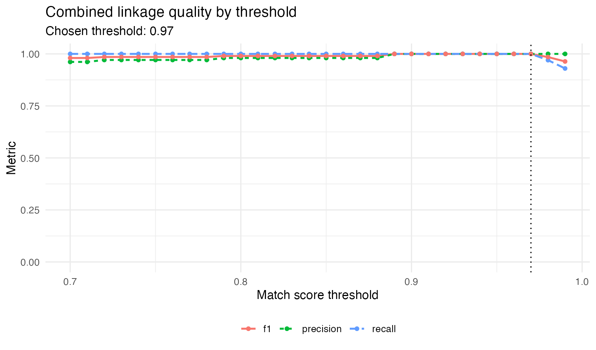

```{=html}
<style>
/* Assignment 8 only: preserve the shared course-site layout. */
.assignment-report.assignment08-report {
  min-width: 0;
  overflow-wrap: break-word;
}
.assignment08-report table {
  display: table !important;
  width: 100% !important;
  max-width: 100%;
  table-layout: auto !important;
  border-collapse: collapse;
  margin: 14px 0 24px;
  font-size: 0.88em;
  line-height: 1.5;
}
.assignment08-report table colgroup { display: table-column-group !important; }
.assignment08-report table col { display: table-column !important; width: auto !important; }
.assignment08-report table thead { display: table-header-group !important; }
.assignment08-report table tbody { display: table-row-group !important; }
.assignment08-report table tfoot { display: table-footer-group !important; }
.assignment08-report table tr { display: table-row !important; width: auto !important; }
.assignment08-report table th,
.assignment08-report table td {
  display: table-cell !important;
  width: auto !important;
  min-width: 0;
  padding: 9px 12px !important;
  vertical-align: top;
  white-space: normal;
  overflow-wrap: normal;
  border-bottom: 1px solid #dedede;
}
.assignment08-report table th {
  font-weight: 600;
  border-top: 1px solid #999;
  border-bottom: 1px solid #999;
  background: #f7f7f7;
}
.assignment08-report table caption {
  caption-side: top;
  text-align: left;
  font-weight: 500;
  padding: 0 0 8px;
}
.assignment08-report .cell-output-display,
.assignment08-report .quarto-table-container,
.assignment08-report .table-responsive {
  display: block;
  max-width: 100%;
  overflow-x: auto;
}
.assignment08-report pre { max-width: 100%; overflow-x: auto; }
.assignment08-report details { margin: 12px 0 18px; }
.assignment08-report img { max-width: 100%; height: auto; }
@media (max-width: 780px) {
  .assignment08-report table { font-size: 0.8em; }
  .assignment08-report table th,
  .assignment08-report table td { padding: 7px 8px !important; }
}
.assignment08-report details.audit-table { max-width: 100%; overflow-x: auto; }
.assignment08-report figure img { display: block; margin: 0 auto; }
</style>
```

:::: {.assignment-report .assignment08-report}

# Assignment 8: Record Linkage

**Linking Simulated Teacher Retirement and Certification Records**  
EPPS 6302 · Fall 2026 · November 26, 2026

## 1. Research question and readings

How many individuals appear in both the Teacher Retirement System (TRS) and Texas Education Agency (TEA) files? Linking retirement and certification information requires inferring whether records describe the same person.

**Fellegi–Sunter model.** The model estimates agreement-pattern probabilities among matches and nonmatches, along with the prevalence of matches, allowing posterior match probabilities to be calculated. The workshop instead assigns fixed weights to similarities; these scores are not calibrated probabilities and do not quantify linkage uncertainty directly (Enamorado, Fifield, and Imai 2019, sections 1–2).

**Unique identifiers.** A reliable shared unique identifier permits direct linkage without inferring identity from imperfect personal characteristics. When it is unavailable, the agreement of names and other fields provides uncertain evidence, so probabilistic linkage is needed to address measurement error (Enamorado et al. 2019; Tokle and Bender 2020).

## 2. Data generation and original linkage

The workshop generates 500 records per file, 100 true matches and 249,900 nonmatching pairs. Each scenario resets seed 42 and changes only the corruption rate: first-name abbreviations, surname typos or one-day birth-date shifts. After standardization, Rule 1 requires identical names and birth dates; Rule 2 uses first initials; Rule 3 permits a one-day date difference. Residual pairs receive weighted similarities using the original `stringdist(method = "jw")` default (Jaro distance, `p = 0`). Birth-date similarities are 1, 0.95 or 0 for exact, one-day or larger differences. The original cutoff is strictly greater than 0.95.

| Corruption | Rule 1 | Rule 2 | Rule 3 | Probabilistic | Links | Precision | Recall | F1 |
|---|---:|---:|---:|---:|---:|---:|---:|---:|
| 10% | 90 | 3 | 3 | 3 | 99 | 1.000 | 0.990 | 0.995 |
| 20% | 80 | 9 | 4 | 4 | 97 | 1.000 | 0.970 | 0.985 |
| 40% | 60 | 19 | 12 | 2 | 93 | 1.000 | 0.930 | 0.964 |

Recall falls most, by six percentage points. Precision stays perfect because incorrect pairs do not pass the rules and strict cutoff. Flexible matching recovers many corrupted records, but not all. These are single realizations, not repeated-simulation averages.

## 3. Evaluation, blocking and weights

The original first-100-row slice already includes the entire positive answer key; removing it changes all three metrics by zero. In real data, arbitrary truncation could misclassify genuine links or omit difficult cases. Including deterministic decisions raises recall at 0.95 from 0.04 to 0.97. Corrected evaluation counts true negatives across all 250,000 pairs. Precision is TP/(TP+FP), recall is TP/(TP+FN), and F1 is their harmonic mean.

| Threshold | Original probabilistic recall | Full-key probabilistic recall | Combined recall | Combined precision |
|---|---:|---:|---:|---:|
| 0.70 | 0.070 | 0.070 | 1.000 | 0.1414 |
| 0.85 | 0.070 | 0.070 | 1.000 | 1.0000 |
| 0.95 | 0.040 | 0.040 | 0.970 | 1.0000 |
| 0.99 | 0.000 | 0.000 | 0.930 | 1.0000 |

*Table note:* The sensitivity comparison uses scores at or above each cutoff, original weights, and original pair decisions, before imposing the final greedy one-to-one restriction.

Surname-initial blocking reduces residual comparisons by 88.51%, from 165,649 (407 × 407) to 19,030. All seven remaining true matches survive; recall stays at 0.97 under the original scoring rule. The assignment's illustrative 499 × 499 count is not the actual baseline. Initial-letter typos can nevertheless exclude true matches in other realizations.

| Candidate set | Pairs | Eligible true pairs | True pairs removed | Precision | Recall |
|---|---:|---:|---:|---:|---:|
| Unblocked | 165,649 | 7 | 0 | 1.000 | 0.970 |
| Blocked | 19,030 | 7 | 0 | 1.000 | 0.970 |

Exact-agreement probabilities $m$ (matches) and $u$ (nonmatches) use all known pairs, adding 0.5 to counts and 1 to denominators. Normalized log ratios sum to one. Birth date receives the largest weight because unrelated people rarely share it exactly. At the original strict cutoff, revised weights raise recall to 1.00 without additional false matches. This remains a similarity score, not a fitted Fellegi–Sunter probability model.

| Field | m | u | log(m/u) | Original weight | Revised weight |
|---|---:|---:|---:|---:|---:|
| Last name | 0.925743 | 0.065472 | 2.6490 | 0.40 | 0.175648 |
| First name | 0.905941 | 0.059494 | 2.7231 | 0.30 | 0.180563 |
| Birth date | 0.955446 | 0.000058 | 9.7091 | 0.30 | 0.643789 |

## 4. Threshold calibration and error diagnosis

For estimating overlap, missed people are assigned twice the cost of incorrect links: loss = 2 FN + FP. The final method combines the original deterministic rules with blocked, reweighted similarities and greedy one-to-one selection. Across cutoffs from 0.70 to 0.99 in 0.01 increments, thresholds 0.89–0.97 all yield zero loss. The highest tied cutoff, 0.97, is selected to retain precision without sacrificing recall. Scores at or above this cutoff are accepted.

{width=100%}

| Threshold | TP | FP | FN | Precision | Recall | F1 |
|---|---:|---:|---:|---:|---:|---:|
| 0.70 | 100 | 4 | 0 | 0.962 | 1.000 | 0.980 |
| 0.85 | 100 | 2 | 0 | 0.980 | 1.000 | 0.990 |
| 0.89 | 100 | 0 | 0 | 1.000 | 1.000 | 1.000 |
| **0.97** | **100** | **0** | **0** | **1.000** | **1.000** | **1.000** |
| 0.98 | 97 | 0 | 3 | 1.000 | 0.970 | 0.985 |
| 0.99 | 93 | 0 | 7 | 1.000 | 0.930 | 0.964 |

After excluding accepted endpoints, the fallback REVIEW band [0.92, 0.97) contains no pairs. Correctness is undefined; no manual acceptance is possible. The final method has zero false positives and negatives, so ten examples per type and their field similarities cannot be reported. All four final error-cause counts are zero. The original model missed three matches; lower final cutoffs admit false links and higher ones omit true links.

## 5. Final performance and downstream effects

| Step | Links | TP | FP | FN | TN | Precision | Recall | F1 |
|---|---:|---:|---:|---:|---:|---:|---:|---:|
| Deterministic | 93 | 93 | 0 | 7 | 249,900 | 1.000 | 0.930 | 0.964 |
| Probabilistic only | 7 | 7 | 0 | 93 | 249,900 | 1.000 | 0.070 | 0.131 |
| Combined | 100 | 100 | 0 | 0 | 249,900 | 1.000 | 1.000 | 1.000 |

*Table note:* All rows evaluate against the full answer key. Conditional recall of the probabilistic step among the seven residual true pairs is 1.00. No final record is linked twice.

The final method adds seven correct matches without adding errors. Deterministic linkage alone would underestimate overlap by seven people (7%); the original combined method would underestimate it by three (3%). In general, false positives inflate the count and false negatives reduce it, giving net bias FP − FN. The selected model estimates 100 overlapping individuals, with zero upward or downward error in this simulation.

## 6. Data note and limitations

Source: Karl Ho’s fictional workshop, seed 42, corruption rates 0.10, 0.20 and 0.40. The generator defines truth independently of field similarity. Final settings use the 20% baseline, with no out-of-sample validation. Real files may contain missing fields, simultaneous errors, changed names, duplicates and unequal coverage. Common names and groups with poorer records may face disproportionate linkage errors. An incorrect key would distort weight estimation and evaluation. Independent validation and representative error mechanisms are needed. The linked file cannot establish causality or count teachers outside both systems.

## References

Enamorado, Ted, Benjamin Fifield, and Kosuke Imai. 2019. “Using a Probabilistic Model to Assist Merging of Large-Scale Administrative Records.” *American Political Science Review* 113(2): 353–371. [doi:10.1017/S0003055418000783](https://doi.org/10.1017/S0003055418000783).

Tokle, Joshua, and Stefan Bender. 2020. “Record Linkage.” Chapter 3 in *Big Data and Social Science*, edited by Ian Foster, Rayid Ghani, Ron S. Jarmin, Frauke Kreuter, and Julia Lane. [Chapter 3](https://textbook.coleridgeinitiative.org/chap-link.html).

Ho, Karl. 2026. *EPPS 6302 Record Linkage Workshop and Handout*. Course materials.

## Reproducibility and AI use

The original workshop is preserved locally at `data/assignment08/record_linkage_workshop.R`. Run the extension from the EPPS6302 project. The uploaded results record R 4.4.1 and the original workshop checksum, which matches the supplied script. Only aggregate outputs are posted; generated names and dates remain private. AI assisted with the extension script, numerical checks, interpretation and report drafting. The script was executed in the student's R environment; independent line-by-line review against R documentation and final student revision remain required before submission.

[Download the R extension](assignment08_assets/assignment08.R) · [Session information](assignment08_assets/session_info.txt) · [Corruption experiments](assignment08_assets/corruption_results.csv) · [Blocking results](assignment08_assets/blocking_results.csv) · [Weights](assignment08_assets/weights_table.csv) · [Full-key comparison](assignment08_assets/threshold_comparison.csv) · [Final threshold curve data](assignment08_assets/threshold_curve.csv) · [Review band](assignment08_assets/review_band.csv) · [Step metrics](assignment08_assets/step_metrics.csv) · [Error availability](assignment08_assets/error_availability.csv) · [Downstream bias](assignment08_assets/downstream_bias.csv).

<details>
<summary>Show full R extension code</summary>

```r
# EPPS 6302 Assignment 8 -- extension to Karl Ho's workshop.
# AI-assisted code; review each function against R documentation before submission.
# Run from the EPPS6302 project or its data/assignment08 directory.
suppressPackageStartupMessages({library(tidyverse); library(stringdist); library(logger)})
root <- path.expand('~/Downloads/EPPS6302')
setwd(root)
stopifnot(file.exists('.gitignore'))
ignore <- trimws(readLines('.gitignore', warn=FALSE))
stopifnot(any(ignore %in% c('data/', '/data/')))
work <- file.path('data','assignment08')
out <- file.path(work,'results')
dir.create(out, recursive=TRUE, showWarnings=FALSE)
original <- file.path(work,'record_linkage_workshop.R')
stopifnot(file.exists(original))
# Load only the original function definitions, not the example side effects.
needed <- c('create_trs_data','create_tea_data','create_validation_set',
            'standardize_names','standardize_date','deterministic_linkage')
ws <- new.env(parent=globalenv())
for (e in parse(original)) {
  if (is.call(e) && length(e)==3L && identical(e[[1]],as.name('<-')) &&
      is.symbol(e[[2]]) && as.character(e[[2]]) %in% needed) eval(e,ws)
}
stopifnot(all(vapply(needed,exists,logical(1),envir=ws,inherits=FALSE)))
ids <- c('record_id_a','record_id_b')
fields <- c('last_name_sim','first_name_sim','dob_sim')
w0 <- setNames(c(.40,.30,.30),fields)
clean <- function(d) d %>% mutate(first_name_std=ws$standardize_names(first_name),
  last_name_std=ws$standardize_names(last_name), first_initial=substr(first_name_std,1,1),
  dob_std=ws$standardize_date(dob))
pair_key <- function(x) paste(x$record_id_a,x$record_id_b,sep='|')
empty_pairs <- function() tibble(record_id_a=character(),record_id_b=character())
# All pairwise similarities preserve the workshop's stringdist defaults (p=0).
score_pairs <- function(a,b,block=FALSE) {
  aa <- a %>% transmute(record_id_a=record_id, last_a=last_name_std,
                        first_a=first_name_std, dob_a=dob_std,
                        initial=substr(last_name_std,1,1))
  bb <- b %>% transmute(record_id_b=record_id, last_b=last_name_std,
                        first_b=first_name_std, dob_b=dob_std,
                        initial=substr(last_name_std,1,1))
  if (block) {
    z <- inner_join(aa,bb,by='initial',relationship='many-to-many')
  } else {
    z <- cross_join(select(aa,-initial),select(bb,-initial))
  }
  z %>% transmute(record_id_a,record_id_b,
    last_name_sim=1-stringdist(last_a,last_b,method='jw'),
    first_name_sim=1-stringdist(first_a,first_b,method='jw'),
    dob_sim=case_when(abs(as.numeric(dob_a-dob_b))==0~1,
                      abs(as.numeric(dob_a-dob_b))==1~.95,TRUE~0),
    block_ok=substr(last_a,1,1)==substr(last_b,1,1))
}
# Explicit matrix multiplication (also works for an empty candidate table).
add_score <- function(p,w) {p$match_score <- as.numeric(as.matrix(p[,fields]) %*% unname(w[fields])); p}
# Greedy one-to-one decision, stable ID tie break. Not a global optimal assignment.
unique_links <- function(p, score_col='match_score') {
  if (!nrow(p)) return(p)
  p <- p[order(-p[[score_col]],p$record_id_a,p$record_id_b),,drop=FALSE]
  used_a <- new.env(hash=TRUE,parent=emptyenv()); used_b <- new.env(hash=TRUE,parent=emptyenv())
  keep <- logical(nrow(p))
  for(i in seq_len(nrow(p))) {
    a <- p$record_id_a[i]; b <- p$record_id_b[i]
    if (!exists(a,used_a,inherits=FALSE) && !exists(b,used_b,inherits=FALSE)) {
      keep[i] <- TRUE; assign(a,TRUE,used_a); assign(b,TRUE,used_b)
    }
  }
  p[keep,,drop=FALSE]
}
metric <- function(pred,truth,universe=250000L) {
  p <- unique(pair_key(pred)); t <- unique(pair_key(truth))
  tp <- sum(p %in% t); fp <- length(p)-tp; fn <- length(t)-tp
  precision <- if(length(p)) tp/length(p) else NA_real_
  recall <- if(length(t)) tp/length(t) else NA_real_
  tibble(links=length(p),tp=tp,fp=fp,fn=fn,tn=universe-tp-fp-fn,
         precision=precision,recall=recall,
         f1=if(2*tp+fp+fn>0) 2*tp/(2*tp+fp+fn) else NA_real_)
}
combine <- function(d,p) bind_rows(select(d,all_of(ids)),select(p,all_of(ids)))
# Original experiments: exact original deterministic function and strict > .95.
run_scenario <- function(rate) {
  set.seed(42)
  a <- clean(ws$create_trs_data(500))
  b <- clean(ws$create_tea_data(a,500,100,rate))
  truth <- ws$create_validation_set(a,b,100) %>%
    transmute(record_id_a=trs_record_id,record_id_b=tea_record_id)
  stopifnot(nrow(truth)==100L,anyDuplicated(pair_key(truth))==0L)
  det <- ws$deterministic_linkage(a,b)
  p <- add_score(score_pairs(det$remaining_a,det$remaining_b),w0)
  auto <- filter(p,match_score>.95)
  all <- combine(det$matches,auto)
  actual <- sum(a$first_name_std[1:100]!=b$first_name_std[1:100] |
                a$last_name_std[1:100]!=b$last_name_std[1:100] |
                a$dob_std[1:100]!=b$dob_std[1:100])
  summary <- bind_cols(tibble(corruption_rate=rate,actual_corrupted=actual,
    rule1=det$summary$Matches[1],rule2=det$summary$Matches[2],rule3=det$summary$Matches[3],
    probabilistic=nrow(auto),candidate_pairs=nrow(p),
    duplicated_trs=sum(duplicated(all$record_id_a)),duplicated_tea=sum(duplicated(all$record_id_b))),
    metric(all,truth))
  list(a=a,b=b,truth=truth,det=det,p=p,auto=auto,summary=summary)
}
s <- lapply(c(.10,.20,.40),run_scenario)
corruption_results <- bind_rows(lapply(s,`[[`,'summary'))
base <- s[[2]]; a <- base$a; b <- base$b; truth <- base$truth
D <- base$det$matches; P <- base$p
# Reproduction guard based on the observed original baseline.
stopifnot(nrow(P)==165649L,nrow(D)==93L,nrow(base$auto)==4L,
          base$summary$tp==97L,base$summary$fp==0L)
stopifnot(anyDuplicated(D$record_id_a)==0L,anyDuplicated(D$record_id_b)==0L)
# 2b: isolate effect of key truncation versus adding the deterministic decisions.
grid <- seq(70,99)/100
curve_for <- function(p,d,truth,mode,one_to_one=FALSE) {
  map_dfr(grid,function(t) {
    links <- filter(p,match_score>=t)
    if(one_to_one) links <- unique_links(links)
    bind_cols(tibble(threshold=t,curve=mode),metric(combine(d,links),truth))
  })
}
threshold_comparison <- bind_rows(
  curve_for(P,empty_pairs(),slice_head(truth,n=100),'Original truncated key'),
  curve_for(P,empty_pairs(),truth,'Probabilistic only, full key'),
  curve_for(P,D,truth,'Combined, full key (original pair decisions)'))
key_change <- threshold_comparison %>% select(threshold,curve,precision,recall,f1) %>%
  pivot_wider(names_from=curve,values_from=c(precision,recall,f1))
# 2c: actual blocking BEFORE scoring, compare with original strict threshold.
B <- add_score(score_pairs(base$det$remaining_a,base$det$remaining_b,block=TRUE),w0)
stopifnot(setequal(pair_key(B),pair_key(filter(P,block_ok))))
true_eligible <- sum(pair_key(P) %in% pair_key(truth))
true_removed <- sum(!P$block_ok & pair_key(P) %in% pair_key(truth))
blocking_results <- bind_rows(
  bind_cols(tibble(method='Unblocked',candidate_pairs=nrow(P),true_eligible=true_eligible,true_removed=0L),
            metric(combine(D,filter(P,match_score>.95)),truth)),
  bind_cols(tibble(method='Last-name initial',candidate_pairs=nrow(B),true_eligible=true_eligible-true_removed,true_removed=true_removed),
            metric(combine(D,filter(B,match_score>.95)),truth))) %>%
  mutate(pair_reduction=1-candidate_pairs/nrow(P))
# 2d: estimate exact-agreement m and u on the full known pair universe.
full_pairs <- score_pairs(a,b)
full_pairs$is_true <- pair_key(full_pairs) %in% pair_key(truth)
stopifnot(nrow(full_pairs)==250000L,sum(full_pairs$is_true)==100L)
weights_table <- map_dfr(fields,function(f) {
  agree <- full_pairs[[f]]==1
  m_n <- sum(agree & full_pairs$is_true); u_n <- sum(agree & !full_pairs$is_true)
  m <- (m_n+.5)/(sum(full_pairs$is_true)+1)
  u <- (u_n+.5)/(sum(!full_pairs$is_true)+1)
  tibble(field=f,match_agree=m_n,nonmatch_agree=u_n,m=m,u=u,log_m_u=log(m/u))
}) %>% mutate(weight=log_m_u/sum(log_m_u),original_weight=unname(w0[field]))
stopifnot(all(weights_table$weight>=0),abs(sum(weights_table$weight)-1)<1e-10)
w <- setNames(weights_table$weight,weights_table$field)
# If blocking excludes even one true residual pair, favor recall and keep unblocked.
use_block <- true_removed==0
candidate <- if(use_block) B else P
W <- add_score(candidate,w)
weight_comparison <- bind_rows(
  bind_cols(tibble(weight_scheme='Original',threshold=.95),metric(combine(D,unique_links(filter(candidate,match_score>.95))),truth)),
  bind_cols(tibble(weight_scheme='Normalized log(m/u)',threshold=.95),metric(combine(D,unique_links(filter(W,match_score>.95))),truth)))
# 3: Choose a threshold using explicit loss: missed person costs 2, false link 1.
# In-sample calibration only; the known answer key is used both to estimate and evaluate.
threshold_curve <- curve_for(W,D,truth,'Final combined',one_to_one=TRUE) %>%
  mutate(loss=2*fn+fp)
chosen <- threshold_curve %>% arrange(loss,desc(precision),desc(threshold)) %>% slice(1)
t <- chosen$threshold[[1]]
auto <- unique_links(filter(W,match_score>=t))
final <- combine(D,auto)
stopifnot(anyDuplicated(final$record_id_a)==0L,anyDuplicated(final$record_id_b)==0L)
# REVIEW: among remaining records only, not candidates conflicting with accepted links.
remaining <- W %>% filter(!record_id_a %in% final$record_id_a,!record_id_b %in% final$record_id_b)
review_grid <- map_dfr(grid[grid<t],function(lo) {
  r <- filter(remaining,match_score>=lo,match_score<t)
  ntrue <- sum(pair_key(r) %in% pair_key(truth))
  tibble(lower=lo,upper=t,pairs=nrow(r),true_pairs=ntrue,
         true_share=if(nrow(r)) ntrue/nrow(r) else NA_real_)
})
if(!nrow(review_grid)) review_grid <- tibble(lower=numeric(),upper=numeric(),pairs=integer(),true_pairs=integer(),true_share=numeric())
feasible <- filter(review_grid,true_pairs>0,true_share>=.5) %>% arrange(desc(true_pairs),desc(true_share),desc(lower))
if(nrow(feasible)) {
  review_band <- slice_head(feasible,n=1) %>% mutate(rule='Maximize true candidates with at least 50% correct')
} else {
  lo <- max(.70,t-.05); r <- filter(remaining,match_score>=lo,match_score<t)
  nr <- sum(pair_key(r) %in% pair_key(truth))
  review_band <- tibble(lower=lo,upper=t,pairs=nrow(r),true_pairs=nr,
    true_share=if(nrow(r)) nr/nrow(r) else NA_real_,rule='Fallback five-point band; no qualifying positive-yield band')
}
# 4: metrics on a common universe, plus conditional incremental recall.
step_metrics <- bind_rows(
  bind_cols(tibble(step='Deterministic'),metric(D,truth)),
  bind_cols(tibble(step='Probabilistic only (full key)'),metric(auto,truth)),
  bind_cols(tibble(step='Combined'),metric(final,truth)))
residual_truth <- truth[!pair_key(truth)%in%pair_key(D),,drop=FALSE]
incremental <- metric(auto,residual_truth) %>% select(links,tp,fp,fn,precision,recall,f1) %>%
  mutate(remaining_true=nrow(residual_truth))
final_metric <- metric(final,truth)
downstream_bias <- final_metric %>% transmute(true_overlap=nrow(truth),estimated_overlap=links,
  upward_error=fp,downward_error=fn,net_bias=fp-fn,relative_bias=(fp-fn)/nrow(truth))
# Error diagnosis: score all actual mistakes, even when a true pair was blocked.
# Publish only synthetic IDs and numerical similarities, never names or birth dates.
all_scored <- add_score(full_pairs,w)
fn <- truth[!pair_key(truth)%in%pair_key(final),,drop=FALSE]
fp <- final[!pair_key(final)%in%pair_key(truth),,drop=FALSE]
err <- bind_rows(mutate(fn,error='False negative'),mutate(fp,error='False positive')) %>%
  left_join(select(all_scored,all_of(ids),all_of(fields),match_score,block_ok),by=ids)
if(nrow(err)) {
  deficits <- sweep(1-as.matrix(err[,fields]),2,w[fields],`*`)
  evidence <- sweep(as.matrix(err[,fields]),2,w[fields],`*`)
  err$responsible_field <- ifelse(err$error=='False negative',fields[max.col(deficits,ties.method='first')],
                                 fields[max.col(evidence,ties.method='first')])
  err <- err %>% mutate(cause=case_when(error=='False positive'~'Unrelated people with similar fields',
    last_name_sim<1~'Last-name typo',first_name_sim<1~'First-name abbreviation',dob_sim<1~'Date corruption',TRUE~'No field disagreement'),
    decision_reason=case_when(error=='False positive'~'Accepted wrong pair',
    !paste(record_id_a,record_id_b,sep="|")%in%pair_key(candidate) & !block_ok & use_block~'Blocked or previously linked endpoint',
    !paste(record_id_a,record_id_b,sep="|")%in%pair_key(candidate)~'Previously linked endpoint',match_score<t~'Below threshold',TRUE~'One-to-one conflict'))
} else {
  err$responsible_field <- character(); err$cause <- character(); err$decision_reason <- character()
}
error_counts <- err %>% count(error,cause,name='n')
error_examples <- err %>% group_by(error) %>% arrange(desc(match_score),record_id_a,.by_group=TRUE) %>% slice_head(n=10) %>% ungroup()
error_availability <- tibble(error=c('False negative','False positive'),total=c(nrow(fn),nrow(fp)),
                             examples_available=pmin(10L,total))
# Additional raw-workshop error counts at .95, useful if the chosen model is nearly perfect.
original_quality <- metric(combine(D,base$auto),truth)
# Save only aggregate results, error IDs and scores, no raw administrative records.
outputs <- list(corruption_results=corruption_results,threshold_comparison=threshold_comparison,
  key_change=key_change,blocking_results=blocking_results,weights_table=weights_table,
  weight_comparison=weight_comparison,threshold_curve=threshold_curve,chosen_threshold=chosen,
  review_grid=review_grid,review_band=review_band,step_metrics=step_metrics,
  incremental=incremental,downstream_bias=downstream_bias,error_counts=error_counts,
  error_examples=error_examples,error_availability=error_availability,original_quality=original_quality,
  design=tibble(seed=42,blocking_used=use_block,fn_cost=2,fp_cost=1,
    threshold_rule='>= for calibration; > .95 for workshop comparisons',
    weight_estimation='Full known key; Jeffreys smoothing; normalized log(m/u); in-sample'))
for(nm in names(outputs)) write_csv(outputs[[nm]],file.path(out,paste0(nm,'.csv')))
plot <- threshold_curve %>% select(threshold,precision,recall,f1) %>%
  pivot_longer(-threshold,names_to='metric',values_to='value') %>%
  ggplot(aes(threshold,value,color=metric,linetype=metric)) + geom_line(linewidth=.9) +
  geom_point(size=1.4) + geom_vline(xintercept=t,linetype='dotted') +
  labs(title='Combined linkage quality by threshold',subtitle=paste('Chosen threshold:',t),
       x='Match score threshold',y='Metric',color=NULL,linetype=NULL) +
  scale_y_continuous(limits=c(0,1)) + theme_minimal(base_size=12) + theme(legend.position='bottom')
ggsave(file.path(out,'threshold_curve.png'),plot,width=8,height=4.7,dpi=200)
writeLines(c(capture.output(sessionInfo()),paste('Workshop MD5:',tools::md5sum(original))),file.path(out,'session_info.txt'))
for(nm in c('corruption_results','blocking_results','weights_table','weight_comparison','chosen_threshold','review_band','step_metrics','incremental','downstream_bias','error_availability','error_counts')) {
  cat('\n',nm,'\n'); print(outputs[[nm]],n=Inf,width=Inf)
}
cat('\nAssignment 8 analysis complete. Results:',normalizePath(out),'\n')

```

</details>

::::
